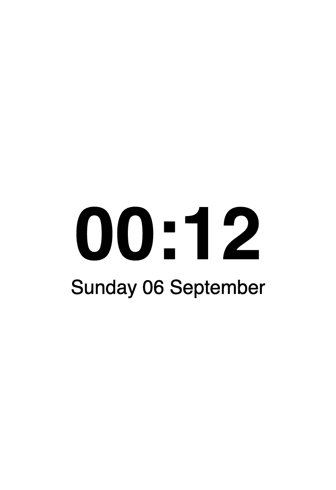

# minimal

The project the README's quickstart builds, ready to copy: one page showing
the time, and a panel that fetches it, draws it, and sleeps.



Four files, nothing else:

```
server.py            the page, and the server that renders and serves it
platformio.ini       which board, and where the epd libraries come from
src/defaults.cpp     your server address, network and password
src/main.cpp         one wake, from beginning to end
```

The two `lib_deps` take epd from the PlatformIO registry, so the directory
builds wherever you copy it. For work on epd itself, `pio run -e dev` builds
it against this checkout.

```sh
pip install "epd-server~=0.15.0" && python3 server.py    # the page, at :8080/clock.png
pio run -t upload                                       # the panel
```

For a panel with an SD card, `pio run -e sd` reads the settings from
`config.yaml` on the card, and `pio run -e sd-dev` does the same against this
checkout. See [configuration.md](../../docs/configuration.md) for the file.
Without `USE_SDCARD`, the `applySdConfig` call in `main.cpp` does nothing.

The picture on the right is `clock.png` as the server renders it: 825 × 1200,
the Inkplate 10 in portrait, in four greys. Four is the kit's default; the panel
can show eight.

See the [OTA example](../ota) for how the server sends a new version of the
panel's own software, which the panel takes at its next wake.
